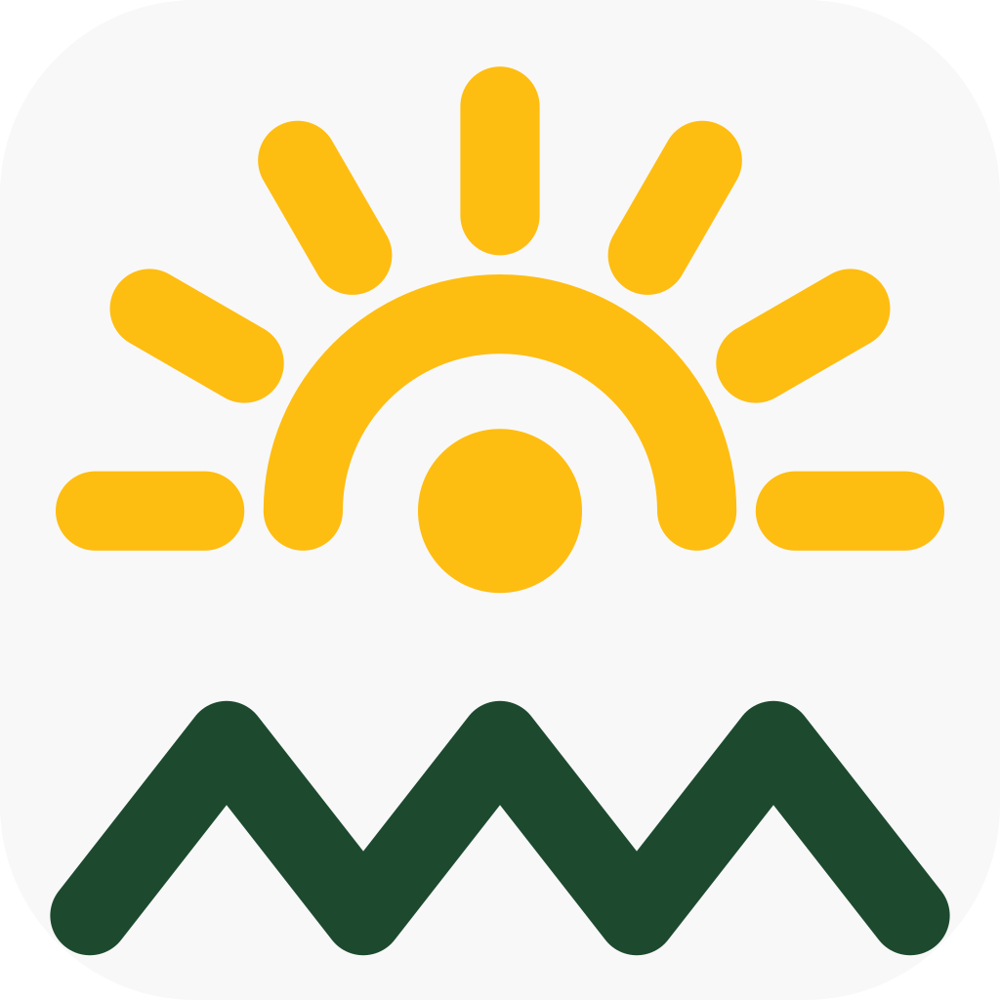
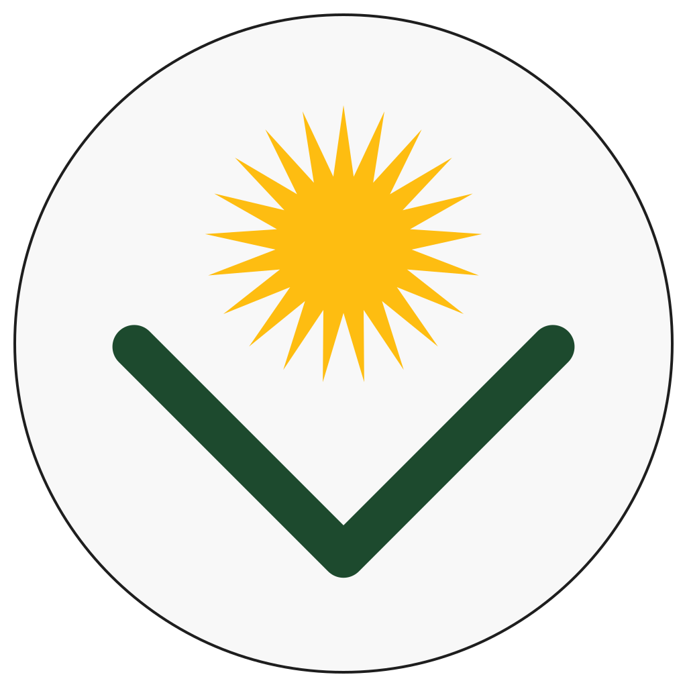
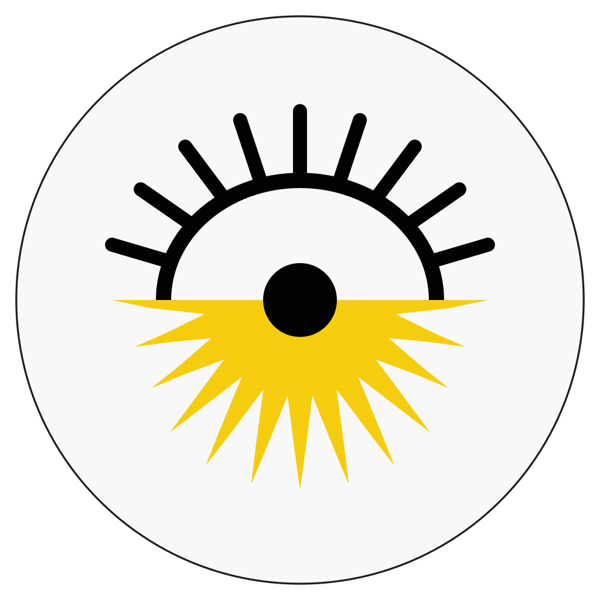
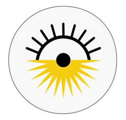
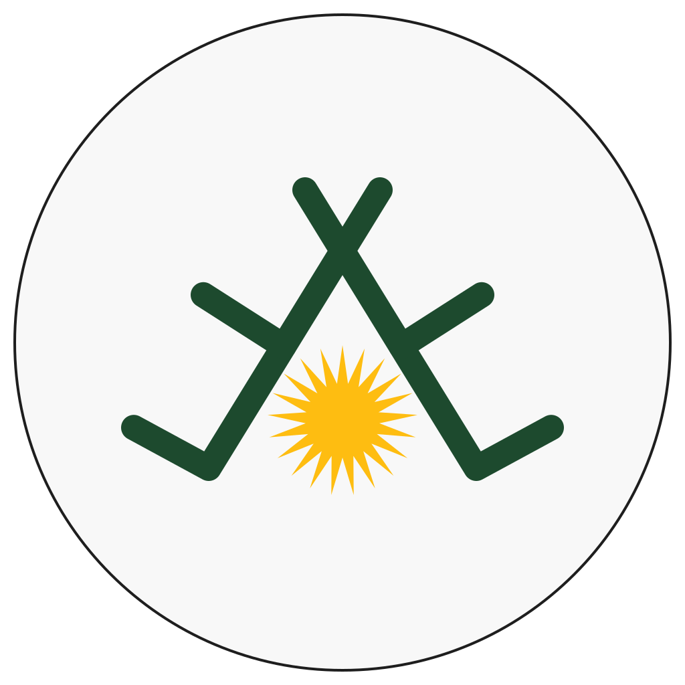
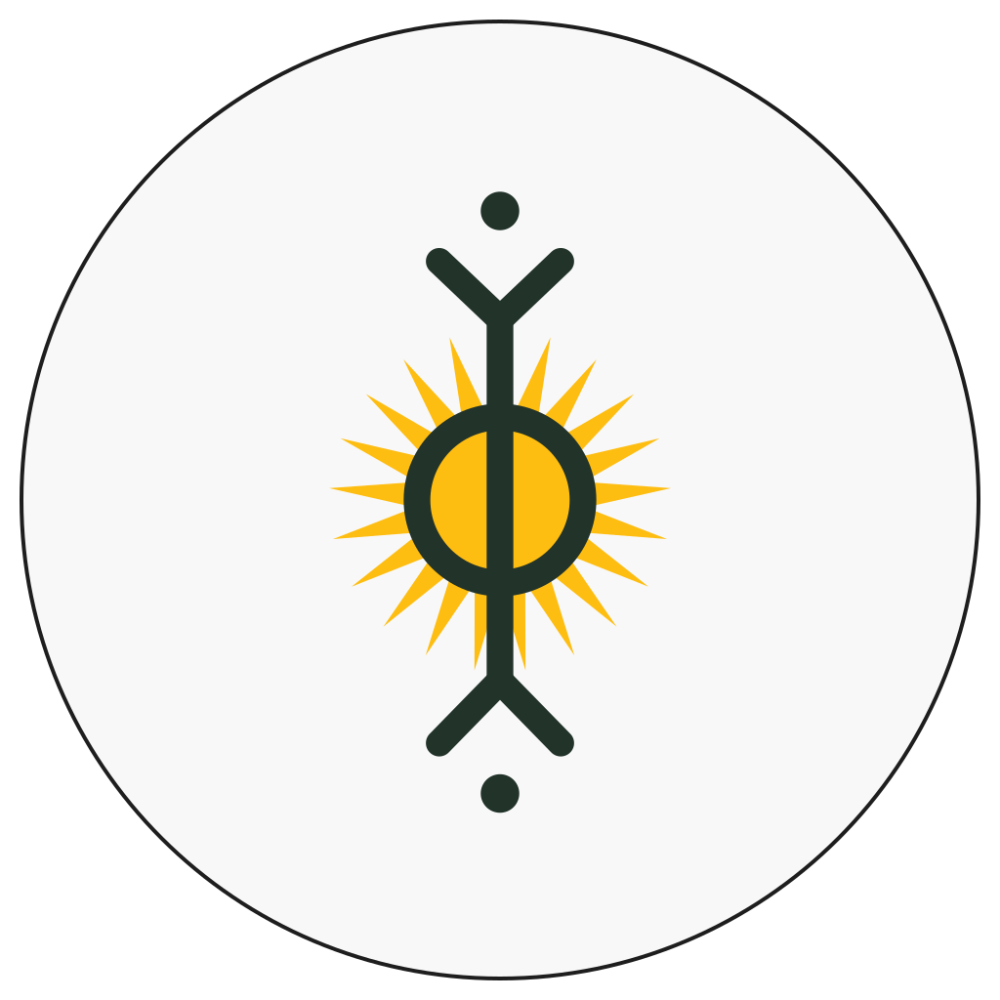
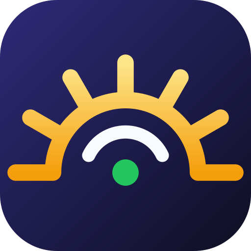
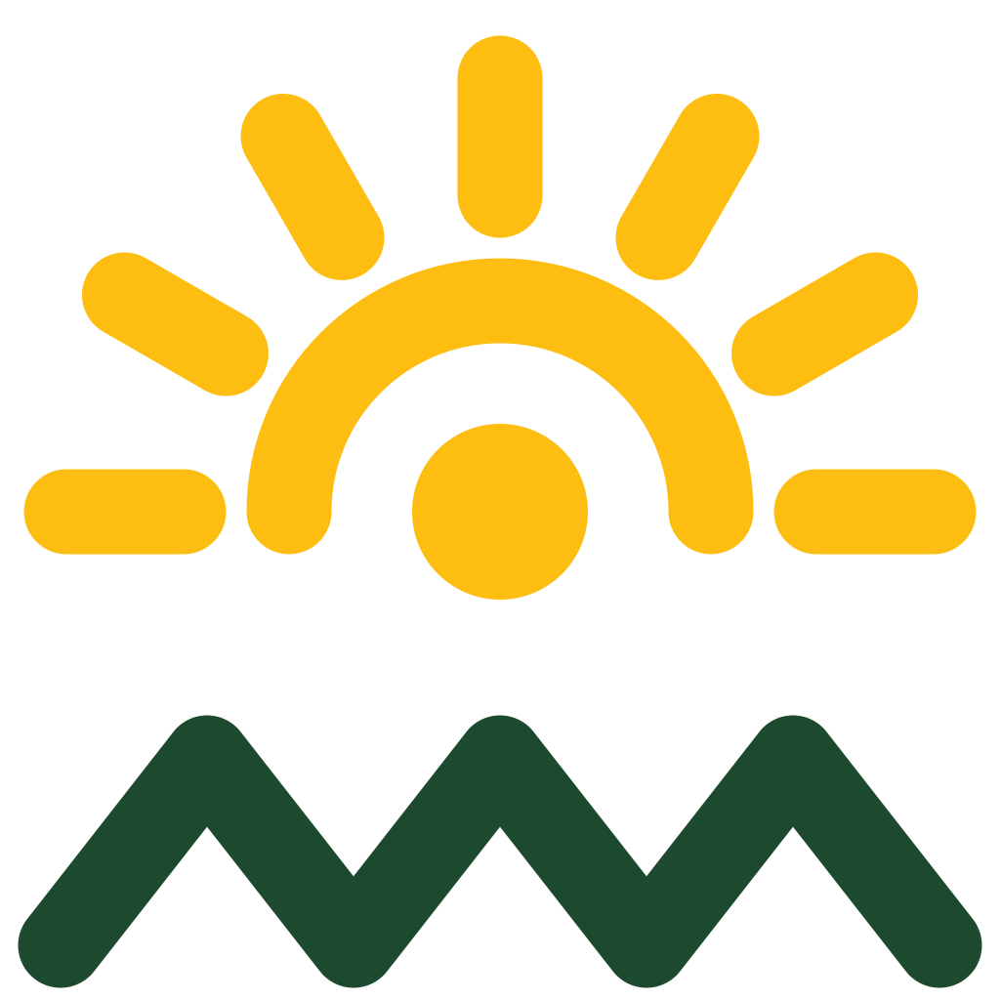

<div align="center">

<a href="https://kanilabs.github.io"></a>

# Kanî Labs

**Open-source tools, from a Kurdish spring.**

[**Visit the website →**](https://kanilabs.github.io) &nbsp;·&nbsp; [Kanî Labs on GitHub](https://github.com/kanilabs)

</div>

*Kanî* (کانی) is Kurdish for a spring, the place where water comes out of the ground: a source. Kanî Labs makes open-source software for Kurdish language and culture, and private, offline-first tools for everyone.

This repository is the source of **[kanilabs.github.io](https://kanilabs.github.io)**, the Kanî Labs website.

## Projects

Every project is free software and works offline wherever it can.

| Project | What it is | Links |
|:---:|---|---|
| <br>**Open Vitae** | A private resume builder that runs entirely in your browser. LTR and RTL, works offline, exports to PDF, Word and more. | [Open the app](https://kanilabs.github.io/open-vitae/) · [Source](https://github.com/kanilabs/open-vitae) |
| <br>**Roj** · ڕۆژ | The Kurdish solar calendar for GNOME Shell, the web and the command line, with Kurdish days for Google Calendar and iPhone. | [Website](https://kanilabs.github.io/roj/) · [Source](https://github.com/kanilabs/roj) |
| <br>**tsroj** | The TypeScript library for the Kurdish solar calendar. | [Docs](https://kanilabs.github.io/tsroj/) · [Source](https://github.com/kanilabs/tsroj) |
| <br>**pyroj** | Kurdish solar calendar and conversions (Gregorian, Persian, tabular Islamic) in Python, standard library only. | [PyPI](https://pypi.org/project/pyroj/) · [Source](https://github.com/kanilabs/pyroj) |
| <br>**Zimanyar** | Offline grammar checker and teacher for Kurdish (Sorani and Kurmanji): browser extension, Linux app, CLI and web. | [Website](https://kanilabs.github.io/Zimanyar/) · [Source](https://github.com/kanilabs/Zimanyar) |
| <picture><source media="(prefers-color-scheme: dark)" srcset="assets/projects/zimankit-dark.svg"></picture><br>**Zimankit** | Kurdish language toolkit: normalisation, IPA, transliteration, morphology, verb paradigms, language ID and wordlists. | [Try it in your browser](https://kanilabs.github.io/zimankit/) · [Source](https://github.com/kanilabs/zimankit) |
| <br>**Tajdîn** | Internet radio always by your side: Kurdish stations and 50,000 more, for Chrome, Firefox and the web. | [Website](https://kanilabs.github.io/tajdin/) · [Source](https://github.com/kanilabs/tajdin) |
| <br>**Deq** · دەق | Traditional Kurdish tattoo shapes as an open, parametric design system: spec, TypeScript, Python and Rust libraries, icons, fonts and Studio. *In development.* | [Source](https://github.com/kanilabs/deq) |

## The mark


The logo is made only of signs from deq, the traditional Kurdish tattoo, as catalogued in [Deq](https://github.com/kanilabs/deq). The **half sun** (an arc, seven rays and a dot) is recorded by wearers and writers as “the source of life”. Below it, the **zigzag** is water: the spring.

<br clear="left">

## Principles

- **Private by default.** Tools work offline wherever they can.
- **Kurdish first, never Kurdish only.** Sorani and Kurmanji, right to left and left to right.
- **Free software.** Most projects are GPL-3.0-or-later.

## About this site

The website is one static page with no build step and no JavaScript, served by GitHub Pages from the `main` branch. It follows the system light or dark theme and works at phone width.

```
index.html          the whole page: markup and styles
assets/brand/       Kanî Labs logo, mark, avatar and banner (from kanilabs/.github)
assets/projects/    each project's logo, copied from its own repository
.nojekyll           serve files as they are, without Jekyll
```

### Preview locally

```sh
git clone https://github.com/kanilabs/kanilabs.github.io.git
cd kanilabs.github.io
python3 -m http.server 8000
```

Then open <http://localhost:8000>.

### Add or update a project

1. Copy the project's logo (SVG preferred, otherwise a PNG of about 256 px) into `assets/projects/`.
2. Add a card to the `#projects` list in `index.html`, following an existing one.
3. Add the same row to the table in this README.

Changes pushed to `main` are live within a minute or two.

---

<div align="center">

<sub>Kanî Labs · <a href="https://kanilabs.github.io">kanilabs.github.io</a> · <a href="https://github.com/kanilabs">github.com/kanilabs</a></sub>

</div>
